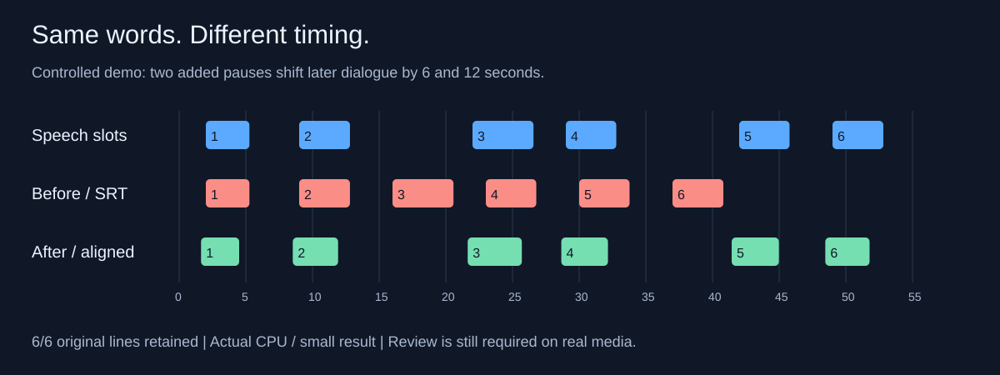

# whisper-srt-aligner

## Fix subtitle timing. Keep the words you already trust.

Subtitles line up at the start, then drift after an intro, recap, or scene cut?
`whisper-srt-aligner` uses the video's speech to rebuild the timing of an existing
SRT, keeping its wording, punctuation, and line breaks for retained cues.

**Video + existing SRT → a newly timed SRT + a review report.**



[Watch the before/after demo](docs/demo/comparison.mp4) ·
[Try the example](docs/demo/README.md) ·
[Installation help](docs/wiki/Installation.md) ·
[Technical documentation / wiki](https://github.com/nd-vs/whisper-srt-aligner/wiki)

## Is this for me?

- You have good subtitle text, but its timing belongs to a different release.
- A single delay adjustment fixes one scene and breaks another.
- You want to process an episode or a whole season locally.

**The subtitles and spoken audio must be in the same language.** This does not
translate subtitles or generate a new script. Quiet lines, overlapping speech,
and substantially different dialogue can still need review.

For a simple constant delay, try a lighter synchronizer first. This tool is
intended for cases where matching the spoken words is useful; it is not a claim
to outperform every other synchronizer. [Choosing an approach](docs/wiki/Reports-and-accuracy.md#choosing-an-approach).

## Windows app — no Python needed

1. [Download the Windows x64 ZIP (0.2.0)](https://github.com/nd-vs/whisper-srt-aligner/releases/download/v0.2.0/WhisperSrtAligner-0.2.0-windows-x64.zip).
2. Extract the **entire** ZIP and open `WhisperSrtAligner.exe`. Keep `_internal` next to it.
3. Install [FFmpeg and FFprobe](docs/wiki/Installation.md#prerequisites), then
   select their `bin` folder in the app if they are not on PATH.
4. Choose your video, original SRT, output SRT, spoken language, and audio track.
5. Click **Align subtitles**, then review the result and report.

Start with the default **CPU / small / int8** settings; no NVIDIA setup is needed.
The first run downloads the selected speech model. Processing stays local.
The interface follows the system language (Russian or English fallback), with a manual switch.

The portable app is unsigned. Keep Windows security protections enabled;
source launch is also available. [Windows app guide and limitations](docs/wiki/Windows-GUI.md).

## Command line / install from source

You need **Python 3.10+** and **FFmpeg** (including FFprobe). A GPU is optional.
[Step-by-step setup for Windows, Linux, and macOS](docs/wiki/Installation.md).

Download this repository's ZIP from **Code → Download ZIP**, extract it, and open
a terminal in the extracted folder. Then install into a virtual environment:

**Windows PowerShell**

```powershell
py -m venv .venv
.\.venv\Scripts\python.exe -m pip install .
.\.venv\Scripts\whisper-srt-align.exe --version
```

**Linux / macOS**

```bash
python3 -m venv .venv
.venv/bin/python -m pip install .
.venv/bin/whisper-srt-align --version
```

No environment activation or Git installation is needed for this route.

## Fix one file

Put your video and SRT in the extracted folder for this first example. On Windows:

```powershell
.\.venv\Scripts\whisper-srt-align.exe sync "episode.mkv" "source.en.srt" --complete --model small --device cpu --compute-type int8 --output "episode.fixed.srt"
```

On Linux/macOS, replace `.\.venv\Scripts\whisper-srt-align.exe` with
`.venv/bin/whisper-srt-align`.

This example is for **English audio and English subtitles**. It uses a smaller
model on the CPU so you can try it without configuring NVIDIA libraries.
The first run downloads the model. Your video and subtitles are processed locally.

For difficult scenes, `large-v3` provides a larger model to try; processing speed
and memory use depend on your hardware. [NVIDIA setup and quality options](docs/wiki/Installation.md#nvidia-gpu-optional).

## Check the result

1. Load `episode.fixed.srt` alongside the video in your player, such as VLC.
2. Check the beginning, a point after each timing jump, and the ending.
3. Open `episode.fixed.alignment.html`. Review **dropped** lines and lines with
   **inferred** timing; they are not confirmed word-for-word by the audio.

Your input files are left unchanged. The tool writes a new SRT; it does not add
the track to the video automatically. [Add it to an MKV](docs/wiki/Usage.md#add-the-result-to-an-mkv).

## A whole season, or a different language?

See [batch processing, audio selection, and other languages](docs/wiki/Usage.md).
You can reuse cached transcripts without running speech recognition again.

## What to expect

- The recommended `--complete` mode uses two recognition passes to recover more
  short and quiet lines. It costs more time than a single pass and can still miss lines.
- Some timing is estimated between confirmed neighboring lines. Unplaceable
  lines are omitted from the output and listed in the report.
- The included demo uses clean synthetic speech and deliberately shifted SRT
  timestamps. It demonstrates the workflow, **not general accuracy on films**.
- SRT is supported; ASS/SSA styling and cross-language alignment are not.

[How it works and known limits](docs/wiki/Reports-and-accuracy.md) ·
[Troubleshooting](docs/wiki/Troubleshooting.md) ·
[Changelog](CHANGELOG.md)

## Help make the first run easier

Tried it on your own files? [Open an issue](https://github.com/nd-vs/whisper-srt-aligner/issues/new/choose)
with your operating system, command, and the point where you got stuck. For timing
issues, include a few subtitle lines and expected timestamps if you can share them;
you do not need to upload an entire video.

MIT license. Powered by [faster-whisper](https://github.com/SYSTRAN/faster-whisper).
