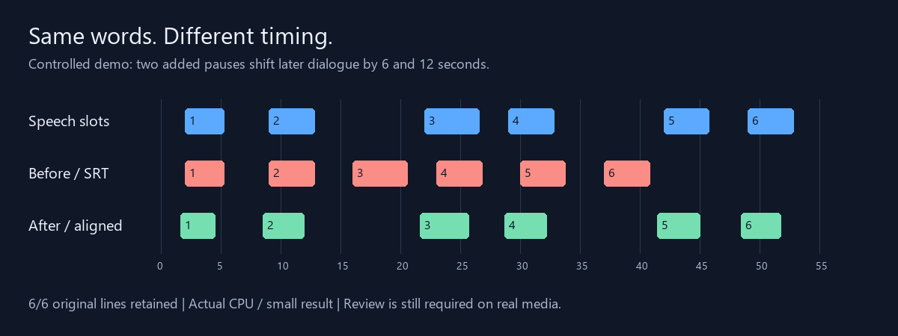

# A reproducible before/after example

[Watch the 57-second comparison](comparison.mp4) · [Listen to the speech](speech.wav)



Six original English sentences are spoken by a Windows synthetic voice. The media
contains two extra six-second pauses that are absent from the source SRT timeline.
Later source cues are therefore six, then twelve seconds early. This represents
changing offsets, not a single delay.

The published result was produced by the application's CPU-first command with no
manual retiming. It is a clean controlled example, **not a film/TV benchmark or a
comparison against other synchronizers**.

## Try it after installation

From the repository root on Windows:

```powershell
.\.venv\Scripts\whisper-srt-align.exe sync docs/demo/speech.wav docs/demo/source.srt --complete --model small --device cpu --compute-type int8 --output "demo.fixed.srt"
```

On Linux/macOS use `.venv/bin/whisper-srt-align` instead. The first run downloads
the `small` model unless already cached. Compare your output with [result.srt](result.srt),
then inspect its HTML report. Minor recognition/timestamp differences can occur
with runtime versions and hardware. To inspect the stored recognition without
running Whisper:

```text
whisper-srt-align align docs/demo/primary-transcript.json docs/demo/source.srt --supplement-transcript docs/demo/supplemental-transcript.json --output demo.from-cache.srt
```

## Actual observed result

| Cue | Media insertion time | Source SRT start | Aligned start |
| --- | ---: | ---: | ---: |
| 1 | 2.00 s | 2.00 s | 1.64 s |
| 2 | 9.00 s | 9.00 s | 8.52 s |
| 3 | 22.00 s | 16.00 s | 21.64 s |
| 4 | 29.00 s | 23.00 s | 28.66 s |
| 5 | 42.00 s | 30.00 s | 41.44 s |
| 6 | 49.00 s | 37.00 s | 48.46 s |

All six original cue texts were retained. Mean absolute start difference from the
known **audio insertion positions** decreased from 6.00 s to 0.44 s; the largest
remaining start difference was 0.56 s. These positions are not human-annotated
phoneme boundaries, and end-time accuracy is not scored. The first two source
starts were already correct and became slightly early: alignment is not perfect.

One run took 8.83 s on an AMD Ryzen 9 9950X3D, Windows/Python 3.12, `small`, CPU/int8,
with the model cached. This excludes installation/downloads and is not a runtime
promise for other hardware or long videos. [Raw measurements](measurements.json),
[report](report.json), [primary transcript](primary-transcript.json),
[supplemental transcript](supplemental-transcript.json).

## Rebuild the assets

To regenerate the synthetic audio you need Windows SAPI with the specified Zira
voice. Everyone can use the committed WAV, SRTs and transcripts without Windows.
Rendering also requires Pillow (`python -m pip install Pillow`) and FFmpeg with
libass support. Paths below name a disposable work folder of your choice.

```text
python scripts/make_demo.py --work-dir <work-folder>
whisper-srt-align sync docs/demo/speech.wav docs/demo/source.srt --complete --model small --device cpu --compute-type int8 --output <work-folder>/result.srt --report <work-folder>/result-report.json --transcript-cache <work-folder>/demo.whisper.json
python scripts/render_demo.py --work-dir <work-folder> --elapsed-seconds <your-measurement> --hardware "<your-hardware>"
```

Measure the actual recognition run and supply its own elapsed value; do not reuse
the published timing for a different run. Scripts overwrite generated demo assets.

The text, fixture timings and graphics are part of this MIT-licensed project.
Speech was generated locally using Microsoft Zira Desktop; no film clips, actors'
recordings, subtitle downloads, or copied benchmark datasets are included.
